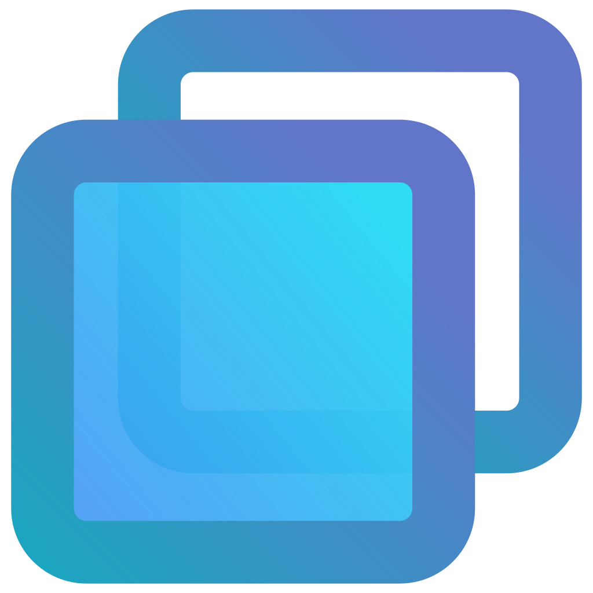

# Glass

<p align="center"></p>

[Glass](https://glassjs.com) was an early (Summer 2024!) vibe-coding tool that let you build websites without looking at your code. We released it at a time when auto-complete was the AI coding standard and when AI couldn't edit files yet, only output text. Coding has come an incredible way since then.

There was some clever engineering involved in order to identify the exact file on your computer that was selected (described below) based on where you clicked on the rendered HTML. We implement something similar to a sourcemap, but with more information. We also do some complex parameter injection so that HTML elements know the exact Component they live on (even though this information is erased when rendering).

Glass is also special because it erases all traces of itself in the code (unlike other similar tools that insert classNames into the sourcecode, which is unacceptable for developer teams).

We open-sourced Glass in November 2026.

## Using Glass

To use Glass, import the npm package `glass-js`, add the `<GlassProvider />` component to your app, and install the SWC plugin to your config.

## Explanation

The relevant directories are `glass-react`, `glass-swc`, and `vscode-extension`. 

The other directories are irrelevant (`babel-extension` is not used, and `www` is a Next.js project that renders what you see on https://glassjs.com).

The names of the attributes below might be wrong, but the ideas are all here:

Glass's SWC plugin essentially takes every `.tsx` file in the codebase and re-writes it, adding `data-glass-info='componentName=..., filePath:..., startLine:..., endLine:..., usedByFunction:..., etc'` to each `<JSX>` tag. This happens to both `<Components>` and primitives like `<div>`, but with slightly different parameters.

In order to identify the exact line of code an instance of a component was from based on where you clicked (which is normally not possible because a component can be used in many places), the SWC plugin also does "parameter injection", modifying all functions to take in a unique identifier. It then modifies all JSX tags to pass in `data-glass-identifier` as an attribute so that the HTML can pick up on it.

In order to implement the core functionality of identifying the file and line number based on an HTML element you click on in the browser, every primitive (`<div>`, etc) gets a `data-glass-info` attribute, containing all of this information. This might seem like a lot of redundant information, compared with e.g. simply putting the information in the root div of the component, but this is the only way to include Fragments `<></>`, which can't have attributes.

The attributes like `data-glass-*` that the Glass SWC adds in never show up in the original sourcecode, and our `GlassProvider` parses and removes them during runtime, so they are nearly invisible during all stages in time.

## Running

1. Add `glass_swc.wasm` to your config:
```
// next.config.js
const nextConfig = {
    experimental: {
        swcPlugins: [
            ['glass-js/swc', {}],
        ],
    }
}
```

Or if you want to use the development version on your own computer:

```
// next.config.js
const nextConfig = {
    experimental: {
        swcPlugins: [
            ['PATH/TO/glass/glass-swc/dist/glass_swc.wasm', {}],
        ],
    }
}
```

2. Add `<GlassProvider />` to your app. 

```
import GlassProvider from "glass-js";
```
Or if you want to use the development version on your own computer:
```
import GlassProvider from "PATH/TO/GlassProvider";
```

3. Run the vscode extension either through the VSCode marketplace, or opening `vscode-extension` inside a separate VSCode window and pressing `F5`.


## Building

To get started developing, run these steps:

Run `pnpm install` to install everything. We use pnpm instead of npm because we're a monorepo and pnpm is more efficient, but it works exactly the same as npm.

Run `npm run build:all` to build both the Glass React bar and the Nextjs swc plugin (this just runs `npm run build` in both folders). 

You don't have to do anything more unless you want to edit the extension. If you want to edit the extension, cd into vscode-extension and run `npm install` (we disabled `pnpm` in vscode-extension because most vscode docs use npm instead).


## Publishing

You can publish two things:

1. Contents of the vscode extension (from `vscode-extension`) to the VSCode marketplace.

2. The `<GlassProvider />` package (from `glass-react`) together with the SWC plugin (from `glass-swc`) to npm.

To publish vscode extension, it's like publishing any other vscode extension. Run `vsce publish`.

To publish the the npm package, run `npm run publish`. Make sure to increment the version number in the relevant package.json or you'll be rejected. Look at the command for more details, but in short it publishes only the built files.

